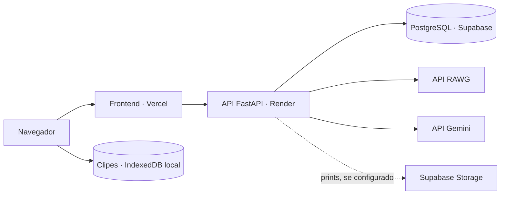

# GameVaultAI

Aplicação full stack para organizar uma biblioteca pessoal de jogos, registrar
sessões e acompanhar o progresso. O projeto integra dados da RAWG e recomendações
com Google Gemini.

## Funcionalidades

- Cadastro e autenticação de usuários com JWT.
- Biblioteca pessoal com busca, filtros, favoritos e paginação.
- Pesquisa e importação de jogos da RAWG.
- Tipos de experiência `STANDARD` e `ONGOING`, com regras de status para jogos contínuos.
- Detalhes, edição, avaliação, horas jogadas e data de conclusão.
- Histórico de sessões, estatísticas e anexos de imagens.
- Gravação de tela associada a uma sessão, com reprodução e download local.
- Recomendações de jogos com Gemini, enriquecidas com informações da RAWG.

## Stack e arquitetura

- **Frontend:** React, TypeScript e Vite.
- **Backend:** FastAPI, SQLAlchemy e Pydantic.
- **Banco de dados:** PostgreSQL, com migrações pelo Alembic.
- **Integrações:** RAWG e Google Gemini (`google-genai`).
- **Infraestrutura local:** Docker Compose.
- **Qualidade:** pytest, ESLint, build do frontend e GitHub Actions.

Na versão publicada, a Vercel hospeda o frontend, o Render executa a API em
container e o Supabase fornece o PostgreSQL. O Supabase Storage pode armazenar
os prints das sessões quando configurado. As gravações de gameplay permanecem
no navegador do usuário.



## Mídia e privacidade

- **Prints das sessões:** enviados à API e armazenados no disco ou no Supabase
  Storage, conforme `STORAGE_BACKEND`.
- **Clipes de gameplay:** capturados após o usuário escolher uma tela ou janela.
  São guardados no IndexedDB deste navegador e dispositivo, associados ao jogo e
  à sessão. Não são enviados ao backend, à nuvem ou ao Gemini. Use **Baixar**
  para exportar uma cópia `.webm`.
- A captura exige um navegador compatível e contexto seguro, como HTTPS ou
  `localhost`. O navegador pede permissão para compartilhar a tela; o áudio
  depende do navegador e da opção escolhida.
- Os clipes locais podem ser removidos ao limpar os dados do site ou se o
  navegador precisar liberar espaço. Baixe os vídeos que quiser preservar. O
  limite atual é de 15 minutos por clipe.
- A análise de vídeos com IA ainda não está implementada. As recomendações atuais
  dependem da disponibilidade e da cota da API Gemini.

## Requisitos

- Python 3.14.5
- Node.js 24 e npm
- Docker Desktop com Docker Compose
- Uma chave da API RAWG para busca, importação e atualização de dados
- Uma chave da API Gemini para recomendações

## Configuração

Inicie o PostgreSQL:

```powershell
docker compose up -d db
```

Crie o arquivo local de configuração e preencha as chaves das APIs:

```powershell
Copy-Item .env.example .env
```

Gere uma chave JWT longa e aleatória:

```powershell
python -c "import secrets; print(secrets.token_urlsafe(48))"
```

Coloque o valor gerado em `SECRET_KEY` no `.env`. `RAWG_API_KEY` e
`GEMINI_API_KEY` habilitam as integrações correspondentes.

`GAMEVAULT_MEDIA_DIR` define onde os anexos de imagem das sessões são salvos.
O padrão é `data/media`; mantenha essa pasta em armazenamento persistente e
inclua-a nos backups do projeto. Cada sessão aceita até 5 imagens JPEG, PNG ou
WebP, com até 5 MB por imagem.

Para usar o Supabase Storage, defina `STORAGE_BACKEND=supabase` e configure
`SUPABASE_URL`, `SUPABASE_SERVICE_ROLE_KEY` e `SUPABASE_STORAGE_BUCKET` no
backend. Crie previamente um bucket privado com o nome configurado. A chave de
serviço é secreta e nunca deve ser configurada no frontend. Com
`STORAGE_BACKEND=local` (padrão), os anexos continuam sendo salvos no disco.

`CORS_ORIGINS` aceita uma lista de origens separadas por vírgula. Para o
frontend, copie `frontend/.env.example` para `frontend/.env` e ajuste
`VITE_API_URL` se a API não estiver em `http://localhost:8000`.

## Executar a aplicação completa com Docker

Copie o exemplo de ambiente. Para um ambiente publicado, configure `SECRET_KEY`
e `POSTGRES_PASSWORD` com valores fortes. Use uma senha de banco formada por
caracteres seguros para URL e mantenha a mesma senha em `DATABASE_URL` ao
executar a API fora do Docker. Os valores do arquivo de exemplo são apenas para
desenvolvimento local.

```powershell
Copy-Item .env.example .env
docker compose up --build -d
```

O Compose inicia o PostgreSQL, aplica as migrações do Alembic antes de iniciar
a API e serve o frontend pelo Nginx. A aplicação fica em
`http://localhost:8080`; a API e sua documentação ficam em `http://localhost:8000`
e `http://localhost:8000/docs`. Os dados do banco e as imagens das sessões
ficam em volumes Docker persistentes. `docker compose down` preserva esses
volumes.

Para publicar o backend usando o Dockerfile, configure `DATABASE_URL`,
`SECRET_KEY`, `CORS_ORIGINS` e as credenciais necessárias no painel do serviço.
O container aplica as migrações do Alembic ao iniciar e usa a porta fornecida
pela plataforma. Para construir o frontend, defina `VITE_API_URL` como o
endereço público da API antes do build. Não use as credenciais de exemplo em
ambientes publicados.

## Arquitetura de produção

Os serviços publicados têm responsabilidades separadas:

1. **Vercel:** compila e hospeda o frontend. Configure `VITE_API_URL` com a URL
   pública do backend; essa variável é incorporada durante o build.
2. **Render:** executa a API a partir do `Dockerfile`. Configure no serviço as
   variáveis do backend, incluindo `DATABASE_URL`, `SECRET_KEY` e
   `CORS_ORIGINS`. A origem permitida deve incluir a URL pública do frontend.
3. **Supabase Database:** fornece o PostgreSQL. Configure sua URL em
   `DATABASE_URL`; o container aplica as migrações do Alembic ao iniciar.
4. **Supabase Storage (opcional):** armazena os prints enviados pelos usuários.
   Configure um bucket privado, `STORAGE_BACKEND=supabase` e as variáveis
   `SUPABASE_*`. A chave `SUPABASE_SERVICE_ROLE_KEY` deve existir somente no
   ambiente do backend.

As chaves RAWG e Gemini também ficam no backend. Indisponibilidade ou limite de
cota nessas APIs pode afetar busca/importação ou recursos de IA, sem afetar os
clipes locais.

Alterações no frontend exigem um novo deploy na Vercel. Alterações no backend
exigem um novo deploy no Render. Se `VITE_API_URL` mudar, o frontend precisa ser
reconstruído para receber o novo endereço.

## Integração contínua

O workflow do GitHub Actions executa `pytest`, ESLint e o build do frontend em
cada push e pull request. Os testes usam SQLite e não precisam de chaves RAWG
ou Gemini nem de um serviço PostgreSQL.

Crie um ambiente virtual e instale as dependências:

```powershell
python -m venv .venv
.venv\Scripts\Activate.ps1
python -m pip install -r requirements.txt
```

## Banco de dados

O PostgreSQL de desenvolvimento é configurado no `.env.example`. A estrutura é
gerenciada pelo Alembic; aplique as migrações antes de iniciar a API:

```powershell
alembic upgrade head
```

Ao atualizar uma instalação existente, essa migração adiciona o tipo do jogo e
classifica os registros atuais como `STANDARD`. Não é necessário apagar ou
recriar o banco de dados.

## Tipos de jogo

`STANDARD` representa jogos com uma conclusão possível. `ONGOING` representa
experiências contínuas, como MMOs e jogos de serviço; esses jogos não podem ser
marcados como `COMPLETED`. Jogos cadastrados e importados da RAWG começam como
`STANDARD`, e o tipo pode ser alterado nos detalhes do jogo.

## Executar a API

```powershell
uvicorn app.main:app --reload
```

Para iniciar a API e o frontend ao mesmo tempo, a partir da raiz do projeto:

```powershell
npm install
npm run dev
```

A documentação interativa fica disponível em
`http://127.0.0.1:8000/docs`.

## Testes

```powershell
pytest -q
```

Os testes usam um banco SQLite separado e mocks para a RAWG e o Gemini; não
fazem requisições reais às APIs externas.

## Sessões de jogo, prints e clipes

As sessões são associadas ao jogo e atualizam o total de horas jogadas. O
PostgreSQL armazena os metadados dos anexos; os arquivos podem ficar no disco
local ou em um bucket privado do Supabase Storage. As rotas de leitura, envio e
exclusão de imagens exigem autenticação JWT.

Você pode registrar uma sessão manualmente, anexar prints e observações, ou usar
**Iniciar sessão com gravação**. Nesse fluxo, a captura começa primeiro; ao
pará-la, informe um comentário opcional e salve a sessão com o clipe. O tempo
gravado preenche a duração da sessão. Os controles da sessão permitem
reproduzir, baixar ou excluir clipes locais. Os comentários podem apoiar uma
análise futura; a análise de vídeos com IA ainda não está implementada.

## Principais endpoints

- `POST /users`: criar usuário
- `POST /login`: obter token JWT
- `GET /games`: listar e filtrar jogos
- `POST /games`: cadastrar jogo
- `GET /games/search`: pesquisar na RAWG
- `POST /games/import/{rawg_id}`: importar jogo da RAWG
- `GET /games/stats`: consultar estatísticas
